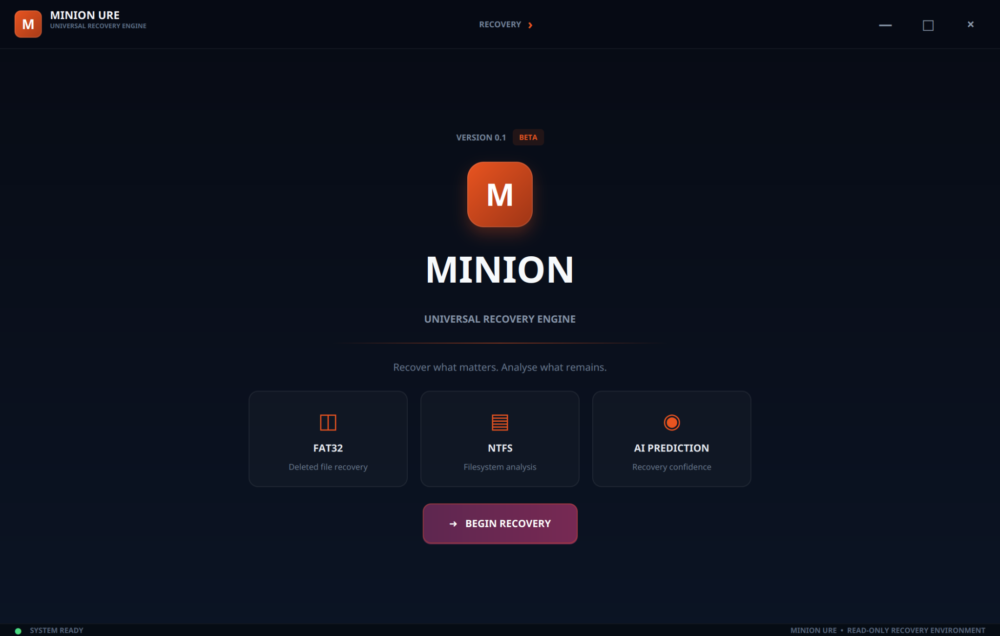
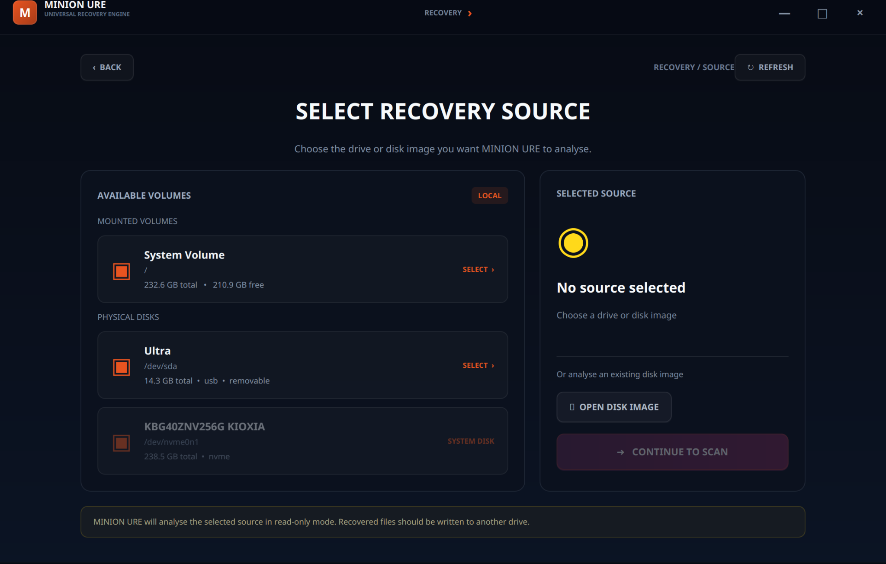

# MINION URE — Universal Recovery Engine

A Java-based data recovery application designed to scan storage devices, analyze supported filesystems, and recover deleted files. The project includes a JavaFX GUI, disk-reading components, filesystem analysis, and a native Linux bridge for read-only disk access.

> **Data safety:** If you need to recover files from a USB drive, stop using it immediately. Do not format it, run filesystem repair tools, or save recovered files back to the same drive. Recovery is not guaranteed, especially when data has been overwritten or the device is failing.

## Contents

- [Features](#features)
- [Requirements](#requirements)
- [Clone the Repository](#clone-the-repository)
- [Build from Source](#build-from-source)
- [Launch the Application](#launch-the-application)
- [USB Recovery Guide](#usb-recovery-guide)
- [Workflow Session](#workflow-session--end-to-end-usb-recovery)
- [Unmounting and Safely Removing USB Drives](#unmounting-and-safely-removing-usb-drives)
- [Troubleshooting](#troubleshooting)
- [Development Notes](#development-notes)

## Screenshots

### Home screen



### Select a recovery source



## Features

- JavaFX graphical interface.
- Physical drive discovery on Linux.
- Read-only disk access through a native UDisks/GIO bridge.
- Partition and filesystem detection.
- FAT32 and NTFS recovery components.
- Disk scanning and deleted-file analysis.
- Recovery result reporting and output writing.
- Recovery prediction components.

Feature availability depends on the current implementation and supported filesystem structures.

## Requirements

The following instructions target Ubuntu or a compatible Debian-based Linux distribution.

| Dependency | Purpose |
|---|---|
| Git | Clone the repository |
| JDK 21 | Compile and run Java |
| JavaFX | GUI components |
| GCC | Compile the native bridge |
| pkg-config | Locate native library dependencies |
| GLib/GIO development libraries | Build the native bridge |
| UDisks2 | Linux storage-device management |

Install the dependencies:

```bash
sudo apt update
sudo apt install git openjdk-21-jdk openjfx build-essential pkg-config libglib2.0-dev udisks2
```

Verify the tools:

```bash
java -version
javac -version
gcc --version
pkg-config --modversion gio-2.0 gio-unix-2.0
```

The commands below use JavaFX JARs installed under `/usr/share/java` on the tested development setup. If your distribution installs JavaFX elsewhere, adjust the paths accordingly.

## Clone the Repository

Using SSH:

```bash
git clone git@github.com:fahimirfanc123/URE.git
cd URE
```

SSH cloning requires a GitHub SSH key configured for your account.

If SSH authentication is not configured, use HTTPS:

```bash
git clone https://github.com/fahimirfanc123/URE.git
cd URE
```

## Build from Source

The repository contains Java sources in multiple source directories. Compile them together so cross-package dependencies are resolved.

### 1. Configure JavaFX

```bash
JFX="/usr/share/java/javafx-base-11.jar:/usr/share/java/javafx-graphics-11.jar:/usr/share/java/javafx-controls-11.jar"
```

Confirm the JARs exist:

```bash
ls -l /usr/share/java/javafx-base-11.jar \
      /usr/share/java/javafx-graphics-11.jar \
      /usr/share/java/javafx-controls-11.jar
```

If they are missing, locate your installed JavaFX JARs and update `JFX`.

### 2. Compile the Java application

```bash
mkdir -p build/classes

find common core filesystem gui src/main/java \
  -type f -name '*.java' -print0 |
  xargs -0 javac -proc:none \
    --module-path "$JFX" \
    --add-modules javafx.controls \
    -cp "/usr/share/java/*" \
    -d build/classes
```

A successful compilation returns to the terminal without compiler errors.

**Important:** Do not use the entire `/usr/share/java` directory as the Java module path. It can contain unrelated JARs and duplicate module names. Use the explicit JavaFX JAR list.

### 3. Compile the native bridge

```bash
mkdir -p build/native

gcc -O2 -Wall -Wextra -Werror \
  $(pkg-config --cflags gio-2.0 gio-unix-2.0) \
  native/ure-disk-helper/udisks_readonly_bridge.c \
  -o build/native/ure-udisks-readonly-bridge \
  $(pkg-config --libs gio-2.0 gio-unix-2.0)
```

Verify the executable:

```bash
test -x build/native/ure-udisks-readonly-bridge \
  && echo "Native bridge compiled successfully"
```

Do not run the entire GUI as root just to access a storage device. Use the intended UDisks authorization and read-only access flow.

## Launch the Application

From the repository root:

```bash
JFX="/usr/share/java/javafx-base-11.jar:/usr/share/java/javafx-graphics-11.jar:/usr/share/java/javafx-controls-11.jar"

java \
  -Dure.native.bridge="$PWD/build/native/ure-udisks-readonly-bridge" \
  --module-path "$JFX" \
  --add-modules javafx.controls \
  -cp "build/classes:resources:/usr/share/java/*" \
  gui.Main
```

The command expects the Java classes and native bridge to have been built successfully.

A successful launch only verifies that the GUI starts. Device discovery, scanning, and recovery should be tested separately using a disposable disk image or nonessential USB device.

## USB Recovery Guide

### 1. Identify the correct device

Connect the USB drive and run:

```bash
lsblk -o NAME,PATH,SIZE,TYPE,FSTYPE,LABEL,MOUNTPOINTS,MODEL,RO
```

Example device names:

- `/dev/sdb` — the whole disk.
- `/dev/sdb1` — its first partition.

**Never assume your USB drive is `/dev/sdb`.** Device names can change between connections. Verify the model, capacity, partitions, and mount points every time.

### 2. Stop using the source drive

Do not copy new files onto it, format it, or attempt filesystem repairs. If the data is irreplaceable and the device is physically failing, consider professional recovery rather than repeatedly scanning it.

### 3. Unmount mounted partitions if required

Use the [unmounting guide](#unmounting-and-safely-removing-usb-drives) below. Unmount the relevant partitions before a raw-device scan when the application's workflow requires exclusive or consistent access.

### 4. Launch URE

Start the application using the launch command above.

### 5. Select the source device carefully

Confirm the drive's identity and capacity. Use the intended read-only scanning workflow. Do not select your operating-system disk by mistake.

### 6. Recover to a different destination

Choose a destination on a separate physical drive whenever possible, with enough free space. Do not write recovered files back to the source USB.

### 7. Validate the recovered files

Check the recovery status and open recovered files from the destination. A file being listed or partially recovered does not guarantee that its contents are complete or usable.

## Workflow Session — End-to-End USB Recovery

This section describes the expected end-to-end recovery session. The exact screen names and available operations depend on the current GUI implementation.

### Workflow overview

```mermaid,
flowchart TD
    A["Connect USB"] --> B["Identify the correct physical drive"]
    B --> C["Check device and partition information"]
    C --> D["Unmount mounted partitions if required"]
    D --> E["Launch URE"]
    E --> F["Select the source drive"]
    F --> G["Analyze device and detect filesystem"]
    G --> H["Scan for recoverable files"]
    H --> I["Review scan results and recovery status"]
    I --> J["Select files to recover"]
    J --> K["Choose a separate destination drive"]
    K --> L["Recover files and validate the output"]
    L --> M["Close URE and safely remove the USB"]


### Phase 1 — Prepare the source device

1. Connect the USB drive.
2. Run `lsblk -o NAME,PATH,SIZE,TYPE,FSTYPE,LABEL,MOUNTPOINTS,MODEL,RO`.
3. Identify the correct physical device using its model, capacity, and partition layout.
4. Stop writing to the source drive.
5. Unmount its mounted partitions if the recovery workflow requires raw-device access.

**Expected result:** The correct source device is identified without selecting an unrelated disk.

### Phase 2 — Start URE

1. Build the Java application and native bridge if they have not already been built.
2. Launch URE.
3. Confirm that the main window opens.
4. Navigate to the drive-selection workflow.

**Expected result:** The GUI starts without JavaFX or native bridge startup errors.

### Phase 3 — Select and analyze the source

1. Refresh the available-device list if necessary.
2. Select the intended USB drive.
3. Verify its identity and capacity again.
4. Start the supported device-analysis or filesystem-detection operation.
5. Review the detected filesystem and any warnings.

**Expected result:** URE identifies the intended source and reports the analysis results. If detection fails, investigate the error instead of guessing the filesystem.

### Phase 4 — Scan for recoverable files

1. Start the supported scan operation.
2. Allow it to finish without unplugging the device or terminating an active scan.
3. Review the discovered files and available metadata.
4. If the scan fails, preserve the terminal output and error details before retrying.

**Expected result:** URE displays scan results for review. The presence of a file in the results does not guarantee successful recovery.

### Phase 5 — Select and recover files

1. Select the files you want to recover.
2. Choose a destination on a different physical drive whenever possible.
3. Confirm that the destination has enough free space.
4. Start recovery.
5. Review the final status for each recovered file.

Recovery status meanings:

| Status | Meaning |
|---|---|
| `EXACT` | The engine reports an exact recovery according to its implemented verification rules |
| `PARTIAL` | Some data was recovered, but the result is incomplete |
| `FAILED` | Recovery did not succeed |

A non-null output file does not by itself mean recovery succeeded. Validate the file's size, content, and ability to open.

**Expected result:** Recovered files are written to the selected destination, not back to the source USB.

### Phase 6 — Finish the session safely

1. Wait for all scanning and recovery operations to finish.
2. Confirm that no active operation is still using the source device.
3. Close URE normally.
4. Unmount the source USB's mounted partitions if they remain mounted.
5. Use the desktop's safe-removal option or the `udisksctl power-off` command for the verified whole-disk device, if supported.
6. Wait for the operation to finish before unplugging the drive.

**Expected result:** The session ends without interrupting device access or risking incomplete writes.

### If a workflow phase fails

Do not immediately repeat the scan or change the source drive. Record:

- The phase in which the failure occurred.
- The selected source device and detected filesystem.
- The operation that failed.
- The full error message or terminal stack trace.
- Whether any output files were created and their reported recovery statuses.

Reproduce bugs with a disposable disk image or nonessential USB whenever possible.

> **Safety rule:** Preserve the source data, use read-only access where supported, and recover to a separate destination. Never format or repair the source as a troubleshooting shortcut.

## Unmounting and Safely Removing USB Drives

Unmounting disconnects a mounted filesystem from its directory. It does not physically disconnect the drive and does not necessarily power it off.

### Method 1: Desktop file manager

1. Open the file manager.
2. Find the USB drive in the sidebar.
3. Click its eject or unmount icon.
4. Wait for the operation to finish before unplugging it.

### Method 2: Terminal

#### Step 1 — Identify the USB partitions

```bash
lsblk -o NAME,PATH,SIZE,TYPE,FSTYPE,LABEL,MOUNTPOINTS,MODEL
```

Inspect the output and identify the USB drive and its mounted partitions.

#### Step 2 — Unmount a partition

For example, if the verified USB partition is `/dev/sdb1`:

```bash
udisksctl unmount -b /dev/sdb1
```

Replace `/dev/sdb1` with the actual partition. Repeat for each mounted partition belonging to that USB drive.

#### Step 3 — Verify that it is unmounted

```bash
lsblk -o NAME,PATH,SIZE,TYPE,MOUNTPOINTS
```

The source partition should no longer show a mount point.

#### Step 4 — Safely power off the device

After unmounting all mounted partitions and completing all operations that use the device:

```bash
udisksctl power-off -b /dev/sdb
```

Replace `/dev/sdb` with the verified whole-disk device, not a partition. This operation may not be supported by every USB device.

Wait for the command to complete before physically disconnecting the drive.

### If unmounting reports that the device is busy

Identify processes using the mount point:

```bash
sudo fuser -vm "/media/$USER/USB"
```

Replace the example path with the actual mount point.

Close file-manager windows, terminals whose current directory is on the USB drive, and applications accessing its files. Then retry the unmount command.

Avoid force-unmounting a drive while a recovery scan, file copy, or write operation is active. Never unplug a drive while URE is reading it.

## Troubleshooting

### 1. `duplicate module on application module path`

**Cause:** The entire `/usr/share/java` directory was supplied as the Java module path. Multiple JARs can expose duplicate module names.

**Solution:** Use only the required JavaFX JARs on `--module-path` and keep other libraries on the classpath:

```bash
--module-path "$JFX" \
--add-modules javafx.controls \
-cp "/usr/share/java/*"
```

### 2. `package javafx... does not exist` or `Module javafx.controls not found`

**Cause:** JavaFX is missing, the JAR paths are incorrect, or the module path is misconfigured.

**Solution:**

```bash
ls -l /usr/share/java/javafx-*.jar
```

Install JavaFX if necessary, then update `JFX` to point to the actual JAR files.

### 3. `ClassNotFoundException` or `NoClassDefFoundError`

**Cause:** Java classes were not compiled, the classpath points to the wrong directory, or a required package was omitted from compilation.

**Solution:** Recompile all Java source directories using the build instructions above. Launch with:

```bash
-cp "build/classes:resources:/usr/share/java/*"
```

Do not assume compiled classes from an old build directory exist in a fresh clone.

### 4. `cannot find symbol` for a class in another source directory

**Cause:** Some classes are under `src/main/java`, while others are in `core`, `filesystem`, and `gui`.

**Solution:** Compile the source trees together:

```bash
find common core filesystem gui src/main/java \
  -type f -name '*.java' -print0
```

If the error remains, verify that the source file is tracked and that its declared Java package matches its imports.

### 5. `pkg-config` cannot find `gio-2.0` or `gio-unix-2.0`

**Cause:** The GLib/GIO development files are missing.

**Solution:**

```bash
sudo apt install build-essential pkg-config libglib2.0-dev
pkg-config --modversion gio-2.0 gio-unix-2.0
```

Retry native bridge compilation after both version checks succeed.

### 6. `ure-udisks-readonly-bridge` is missing

**Cause:** The native executable has not been built, or the launch command points to the wrong location.

**Solution:**

```bash
ls -l native/ure-disk-helper/udisks_readonly_bridge.c
ls -l build/native/ure-udisks-readonly-bridge
```

If the executable is missing, run the native compilation step again.

### 7. The USB drive does not appear in URE

**Possible causes:** Linux cannot detect the drive, the discovery logic cannot identify it, or the native bridge or storage permissions are not configured correctly.

**Check:**

```bash
lsblk -o NAME,PATH,SIZE,TYPE,FSTYPE,MOUNTPOINTS,MODEL,RO
udisksctl status
```

If Linux itself cannot see the device, investigate the USB port, cable, enclosure, or drive before debugging the GUI.

Do not disable read-only safeguards or run the entire application as root as a first workaround.

### 8. `Device or resource busy` when unmounting

**Cause:** A file manager, terminal, or application is accessing the mounted filesystem.

**Solution:** Close applications using the mount point, inspect processes with `fuser`, and retry `udisksctl unmount`. Do not unplug the drive while URE is scanning it.

### 9. The GUI launches, but scanning or recovery fails

**Cause:** Successful GUI startup does not prove that device discovery, filesystem detection, scanning, or recovery works.

**Solution:** Record the full terminal output, confirm the selected source device, verify the native bridge path, and test against a disposable disk image.

### 10. Recovered files are incomplete or cannot be opened

**Cause:** The file may have been overwritten, fragmented, partially damaged, or only partially recovered.

**Solution:** Check URE's recovery status and the recovered file's size. Save results to a different destination and test with nonessential sample files before relying on recovery results.

### 11. `Permission denied` while accessing a drive

**Cause:** Device permissions or UDisks authorization may prevent access.

**Solution:** Check whether the device is visible through `lsblk` and `udisksctl status`, then inspect the native bridge error. Follow the intended read-only access path. Avoid running the entire JavaFX application with `sudo`, which can create root-owned files and bypass normal desktop authorization.

## Development Notes

- Repository: [fahimirfanc123/URE](https://github.com/fahimirfanc123/URE)
- Main class: `gui.Main`
- Native bridge source: `native/ure-disk-helper/udisks_readonly_bridge.c`
- Native bridge output: `build/native/ure-udisks-readonly-bridge`
- Java output directory: `build/classes`
- JavaFX stylesheet: `resources/css/main.css`

Build output is generated locally. A fresh clone must compile the Java application and native bridge before launch.

When reporting bugs, include:

1. The command you ran.
2. The full error message or terminal stack trace.
3. The output of `java -version`.
4. The output of `lsblk`, with sensitive device labels removed if necessary.
5. Whether the issue occurs during startup, discovery, scanning, or recovery.

Always reproduce bugs with test images or nonessential media whenever possible.

## License

This project is licensed under the MIT License. See [LICENSE](LICENSE) for the full text.
